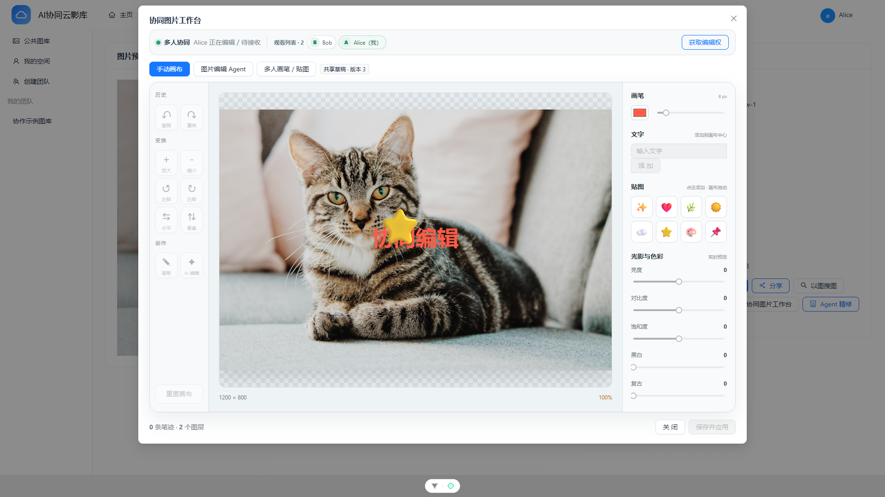
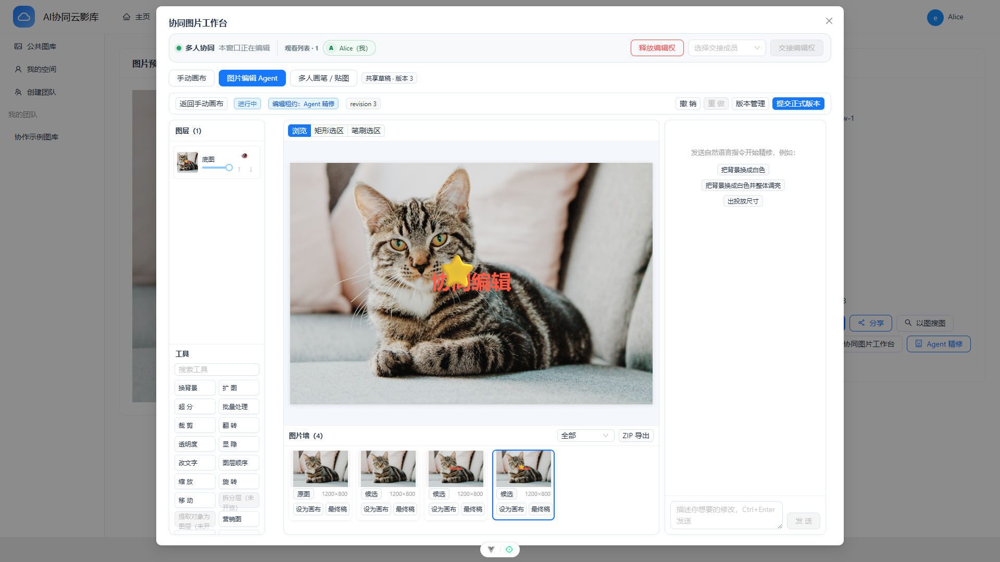
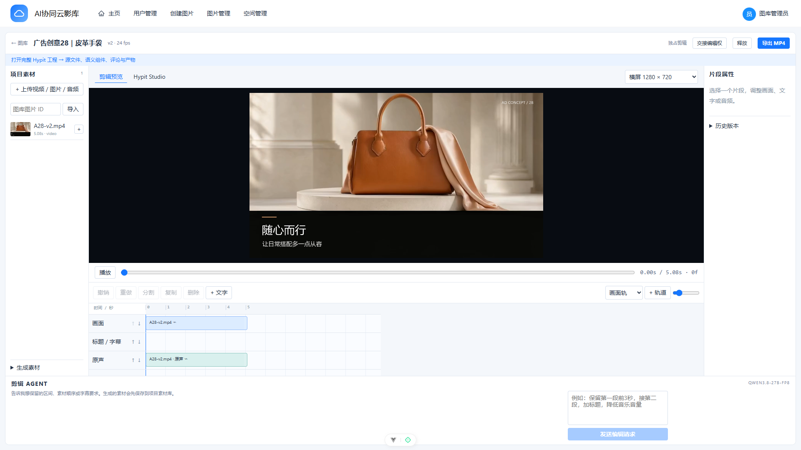

# AI 协同云影库

面向图片、视频与 AI 创作的多人协同资产平台。

`Spring Boot` · `Vue 3` · `WebSocket` · `Redis` · `MySQL` · `FastAPI + ChromaDB` · `Node.js + FFmpeg`

> 以下截图均来自当前运行系统的真实浏览器，窗口尺寸为 `1920 × 1080`。

## 资产图库

### 图库总览

### 智能向量以图搜图

### 团队空间与权限

## 图片协同编辑

### 双页面协同

<table>
  <tr>
    <th>Alice 编辑者页面</th>
    <th>Bob 协作者页面</th>
  </tr>
  <tr>
    <td></td>
    <td></td>
  </tr>
</table>

### AI 图片编辑 Agent

## 视频协同工作台

## 后台与工程能力

### 空间图库分析

### 本机运维控制台

