# AI 协同云影库

面向图片、视频与 AI 创作的多人协同资产平台。

`Spring Boot` · `Vue 3` · `WebSocket` · `Redis` · `MySQL` · `FastAPI + ChromaDB` · `Node.js + FFmpeg`

## 资产图库

### 图库总览

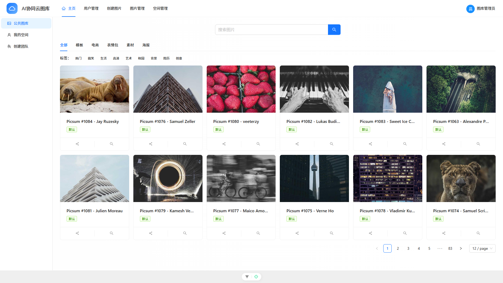

### 以图搜图

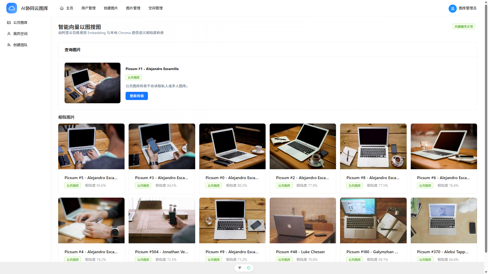

### 团队空间

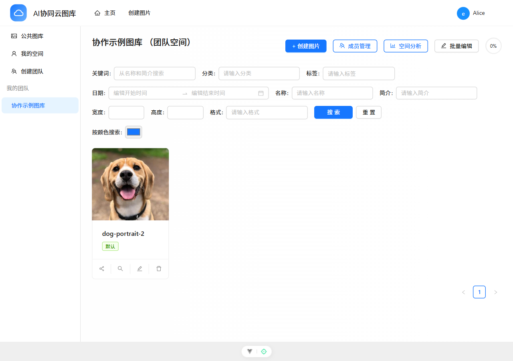

## 图片协同编辑

### 双页面在线协同

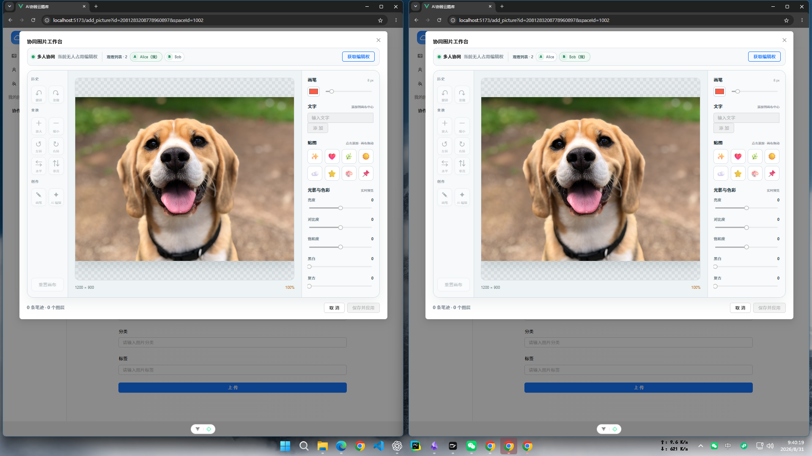

### 画笔、文字与图层实时同步

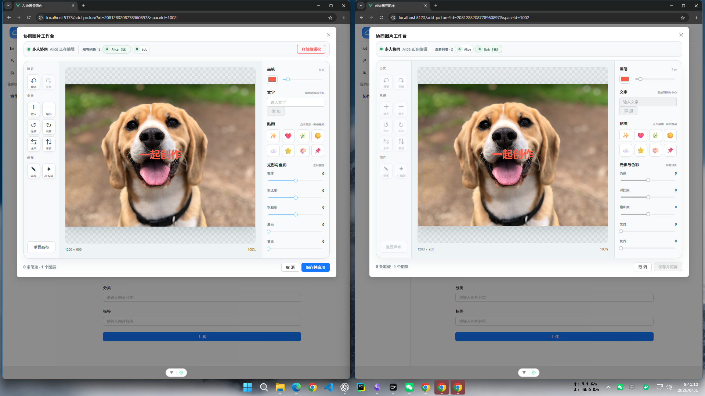

### 编辑权交接

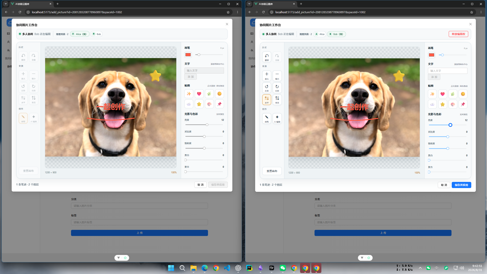

### AI 图片编辑 Agent

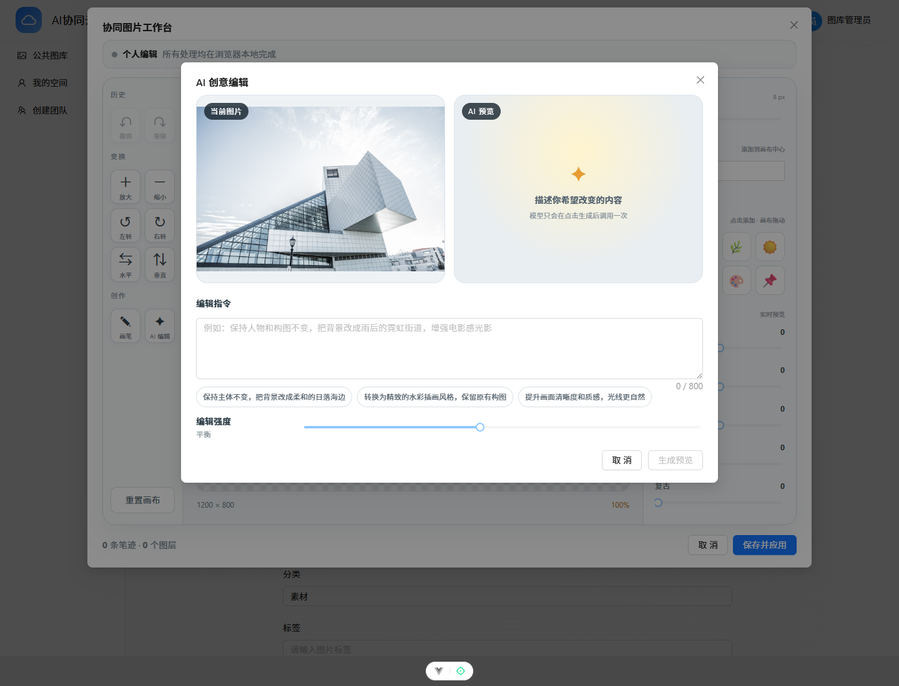

## 视频协同工作台

<table>
  <tr>
    <th>编辑者页面</th>
    <th>协作者页面</th>
  </tr>
  <tr>
    <td>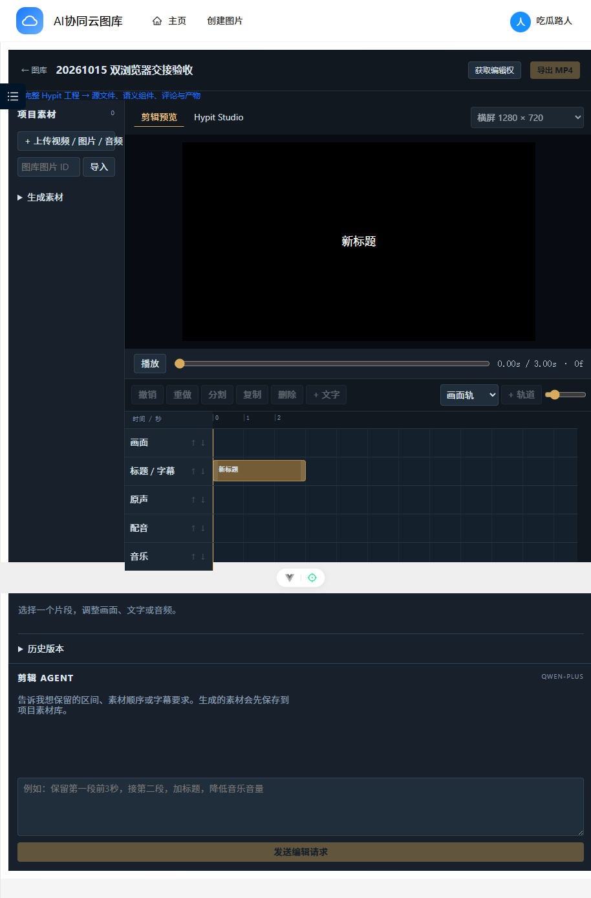</td>
    <td>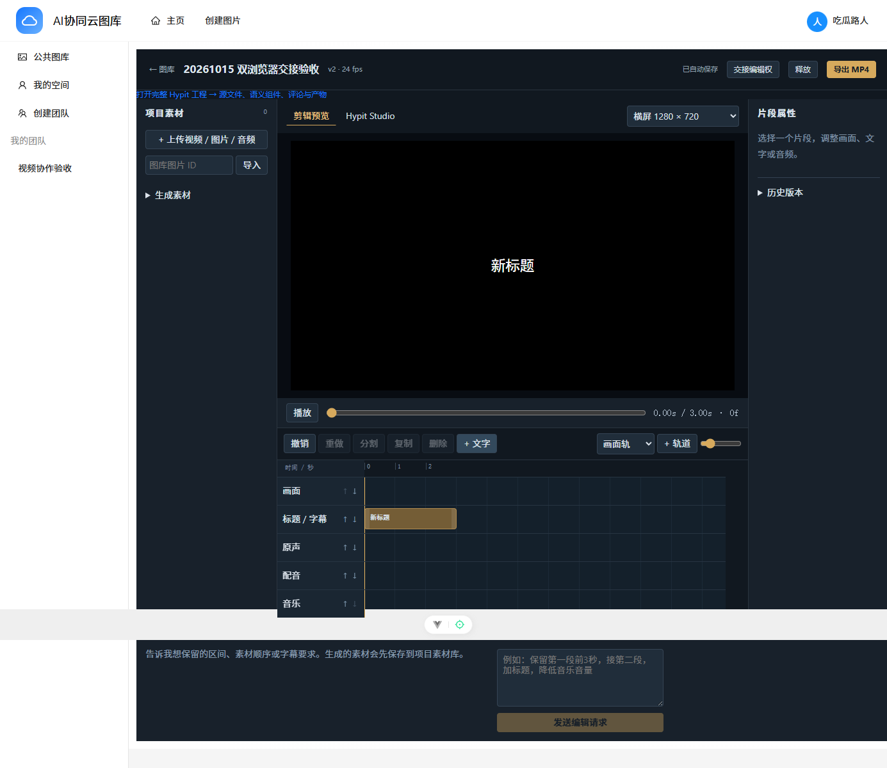</td>
  </tr>
</table>

## 后台与工程能力

### 空间图库分析

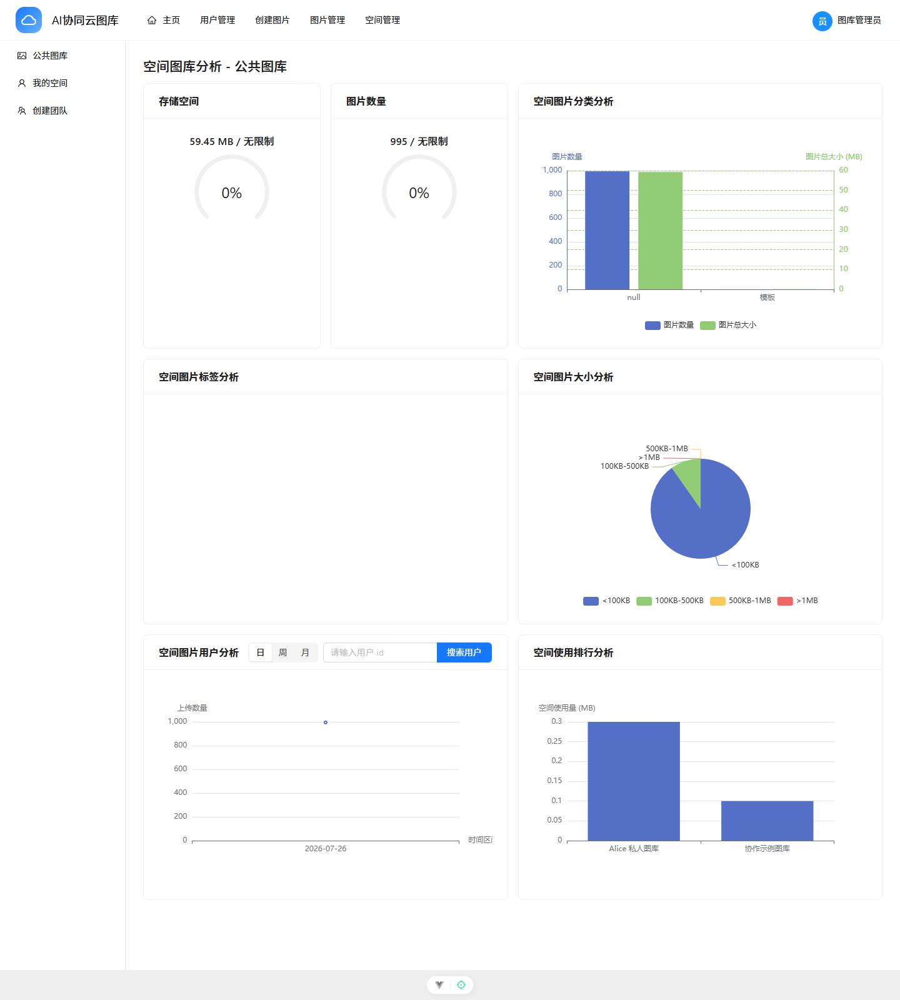

### 连接与运行配置

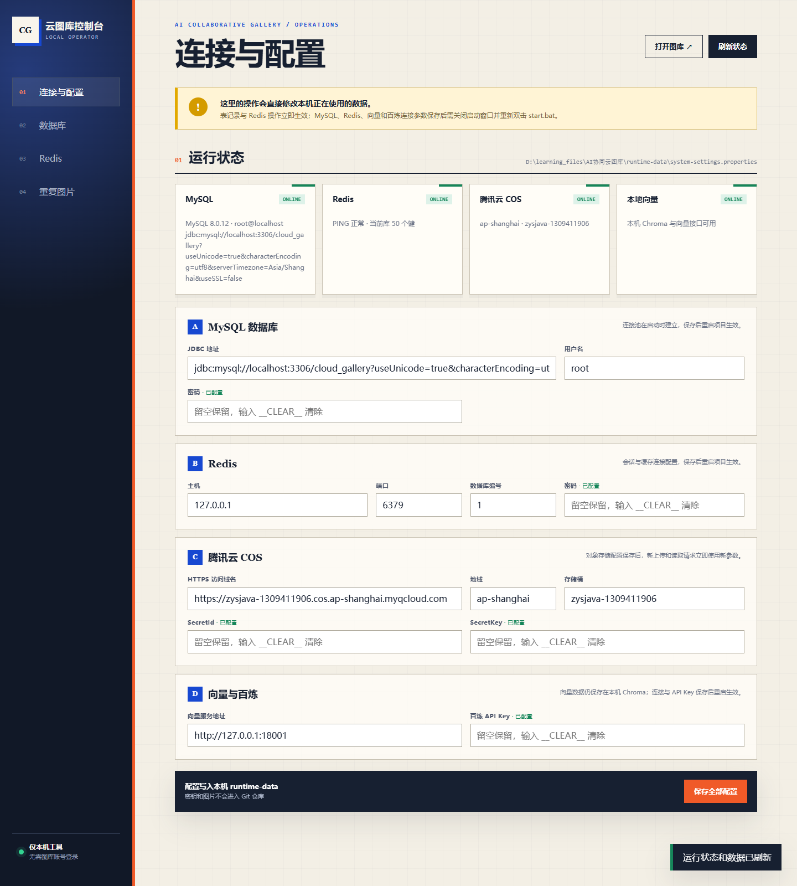
